# PHASE-2

In this phase, I implemented a GPT-style model (code located in `{Language}\models\`) that I then pre-trained with the corpus collected in phase-1. I then did my analysis, which I will note in this report.


> I will split this report in 3 sections, - Implementation, - Results, - Conclusion


## IMPLEMENTATION

As mentioned before, the code files of implementation of both models is in [Telugu](Telugu/model/) and [Nepalese](Nepalese/model/), both of these code files are completely identical (copy-paste). The transformer implementation is spread out in 3 files (attention.py, positional.py, transformer.py).

### ATTENTION

**Scaled Dot Product Attention**: The foundational equation is implemented in this function `scaled_dot_product_attention` in `attention.py`:
```py

## The formula is implemented in this way in python/torch

attn_logits = (torch.matmul(q, k.transpose(-2, -1))/ math.sqrt(d_k))
output = torch.matmul(attention, v)

```

**Multi-Head Attention**: I implemented multihead attention in `MultiHeadAttention` in `attention.py`:


```py

## Abbridged MHA implementation

self.qkv_proj = nn.Linear(input_dim, 3 * embed_dim)
self.o_proj = nn.Linear(embed_dim, input_dim)

qkv = self.qkv_proj(x)
values, attention = scaled_dot_product_attention(q, k, v, self.attn_dropout, mask=mask)

o = self.o_proj(values)

return o
```

### POSITIONAL EMBEDDING

I implemented Rotary Positional Embedding. The reasons for choosing it over Learned PE or Sinusoidal PE:

- Sinusoidal PE has fixed sequence length over training time
- In RoPE there are no learnable parameters, hence making it more extensible

Essentially I just chose RoPE because it is imo the most popular PE and is relatively easy to implement.


RoPE works by rotating Q and K matrices by doing matrix multiplications before the attention mechanism over every layer.

Implementation is in positional.py.

```py
## Abbridged Implementation of RoPE
def rotate_half(x: torch.Tensor) -> torch.Tensor:
    x = x.reshape(*x.shape[:-1], -1, 2)
    return torch.stack((-x[..., 1], x[..., 0]), dim=-1).flatten(-2)

def apply_rotary_pos_emb(x, cos, sin, rotary_dim):
    rotated, remainder = x[..., :rotary_dim], x[..., rotary_dim:]
    rotated = rotated * cos + rotate_half(rotated) * sin
    return torch.cat((rotated, remainder), dim=-1)
```

### Transformer

Implemented like:

Self-attention Sublayer:
LayerNorm -> Self Attention -> Dropout

Feed-forward Sublayer:
LayerNorm -> FFN -> Dropout

```py
# -------------------------
# Self-attention sublayer
# -------------------------
residual = x

x_norm = self.ln1(x)

if return_attention:
    attn_out, attention = self.attn(
        x_norm,
        mask=mask,
        return_attention=True,
    )
else:
    attn_out = self.attn(
        x_norm,
        mask=mask,
        return_attention=False,
    )

x = residual + self.attn_dropout(attn_out)
# -------------------------
# Feed-forward sublayer
# -------------------------
residual = x

x_norm = self.ln2(x)
ff_out = self.ffn(x_norm)

x = residual + ff_out

if return_attention:
    return x, attention

return x
```

I have glossed over other less important details. They can be found in models/. i believe I went over the most important blocks and how I implemented them.


## RESULTS

### Intrinsic Metrics

#### Perplexity and Bits-per-Byte
Calculated in `{Language}/eval/metrics.py`:

**Telugu**


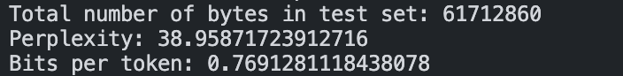


**Nepalese**


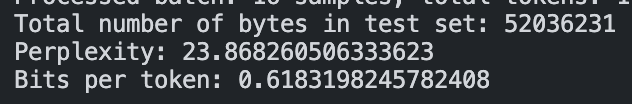

#### Possible Interpretations


### Generation Evaluation

**Telugu**


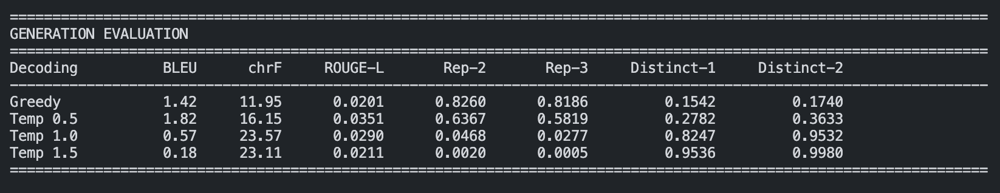


**Nepalese**


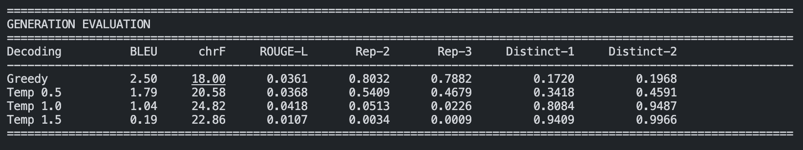


#### Possible Interpretation

**coherence and language correctness**:
Note that, I cant read either of these languages (nepalese a little bit maybe). I gave it to GPT and verified that the language was coherent although did not make sense.


### Attention Evaluation

#### Attention Heatmaps

**Telugu**

- Layer 0 (early layer):
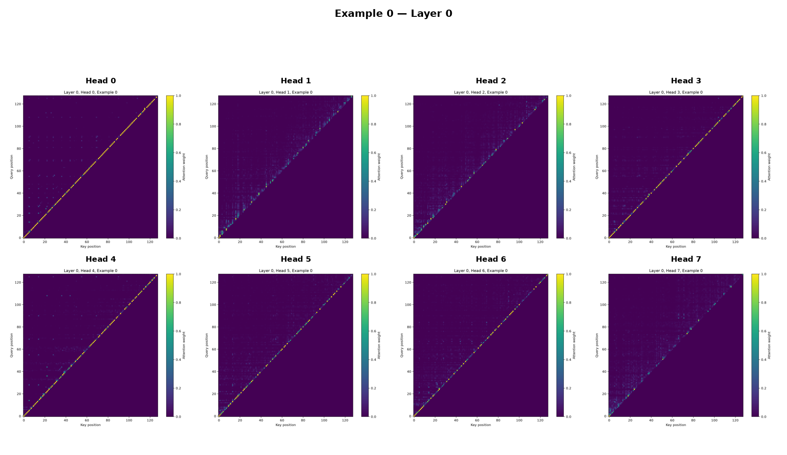

- Layer 3 (middle layer):
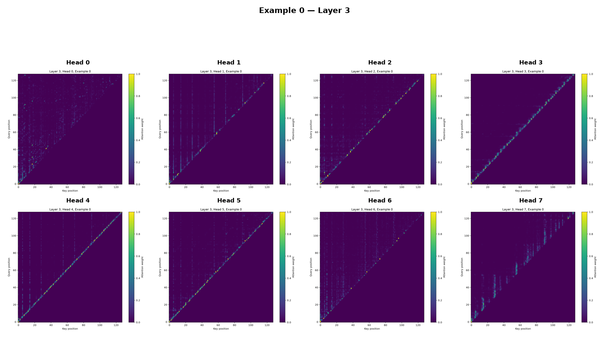


- Layer 7 (late layer):
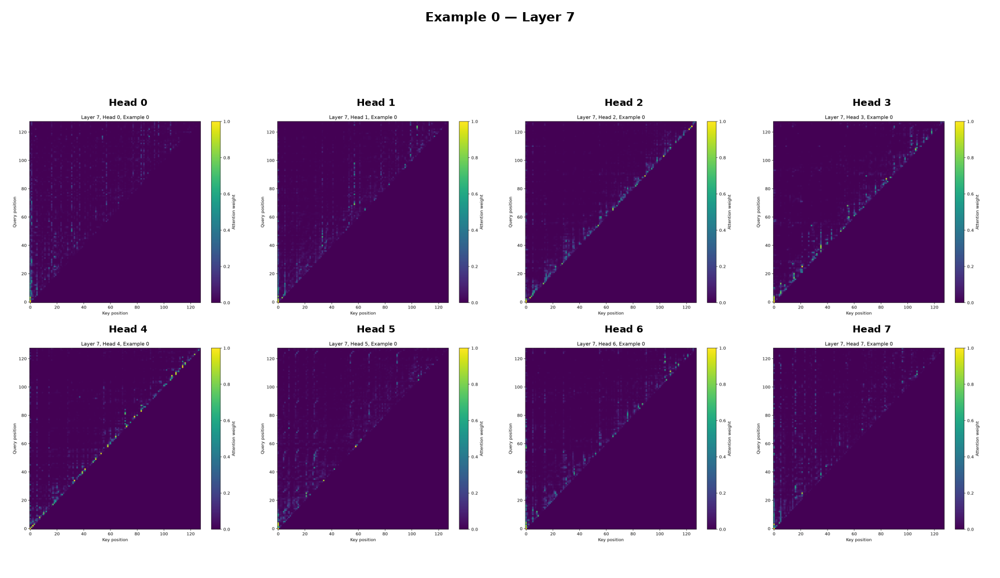


Example text for all these plots are:

పనిచేసింది. అల్ ఇండియా అస్సాం రైతుల సమావేశానికి కూడా నాయకత్వం వహించింది. 1972 లో భారత ప్రభుత్వం ఆమెను పద్మశ్రీతో సత్కరించింది. మళ్లీ 2002 లో, భారత ప్రభుత్వం ఆమె గౌరవార్థం స్మారక స్టాంపును విడుదల చేసింది. మరణం, వారసత్వం సైకియాని తన 72 వ పుట్టినరోజు నాడు, 1972 మార్చి 16 న క్యాన్సర్తో మరణించింది ఆమె మరణానికి కొన్ని నెలల ముందు,1972 లో, భారత ప్రభుత్వం ఆమెకు పద్మశ్రీ పురస్కారం ప్రదానం చేసింది. 2002 లో పోస్ట్ డిపార్ట్మెంట్ ఆఫ్ పోస్ట్స్ ద్వారా సంఘ సంస్కర్తల స్మారక తపాలా బిళ్ళను విడుదల చేసి ప్రభుత్వం ఆమెను సత్కరించింది. గౌహ


**Nepalese**

- Layer 0 (early layer):
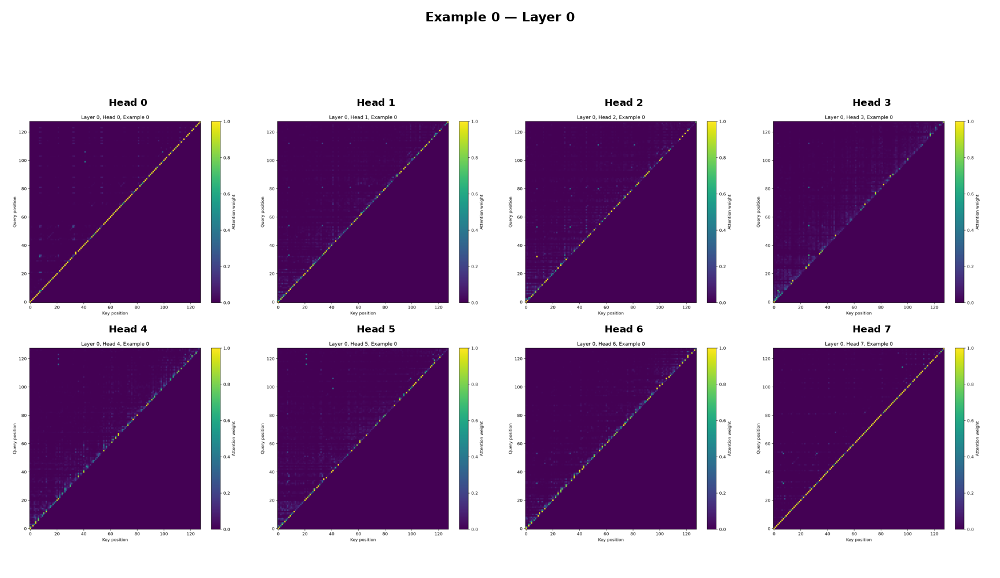

- Layer 3 (middle layer):
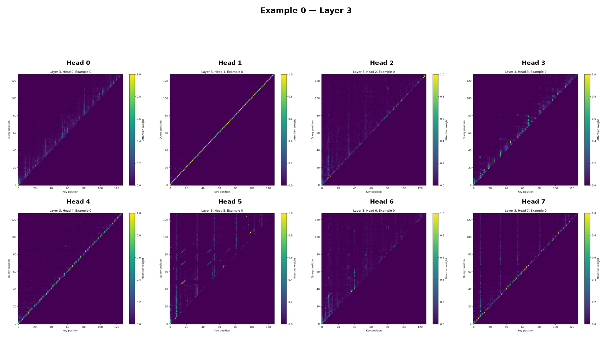


- Layer 7 (late layer):
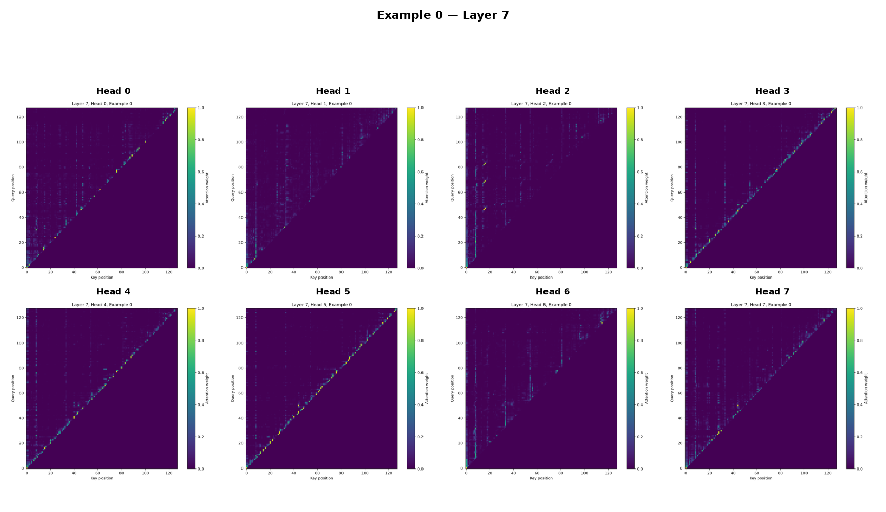


Example text for all these plots are:


बजाना (विविध मनोरञ्जनात्मक मैथिली गीतहरूको श्रव्यसँगालो), प्रकाशकः गङ्गा क्यासेट, नयादिल्ली, भारतः २०६३ भजन दिव्यानन्द (चट्याङ मास्टरद्वारा रचित नेपाली भक्तिरचनाहरूको रूका श्रव्यसँगालो), प्रकाशकः कान्ता गौतम, काठमाडौँ, नेपालः २०६१ वन-गीत (संरक्षणसम्बन्धी चेतनामूलक मैथिली गीतहरूको श्रव्यसँगालो), प्रकाशकः बाइसेप एसटी, काठमाडौँ, नेपालः २०६१ शैक्षिक कृतिहरू खिस्सा-पिहानी (मै


#### Attention Entropy

**Telugu**

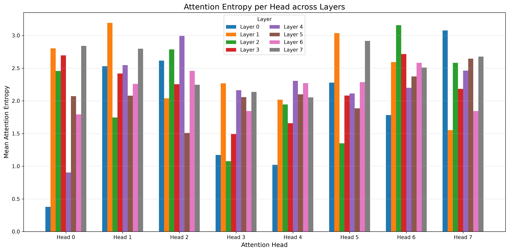

**Nepalese**

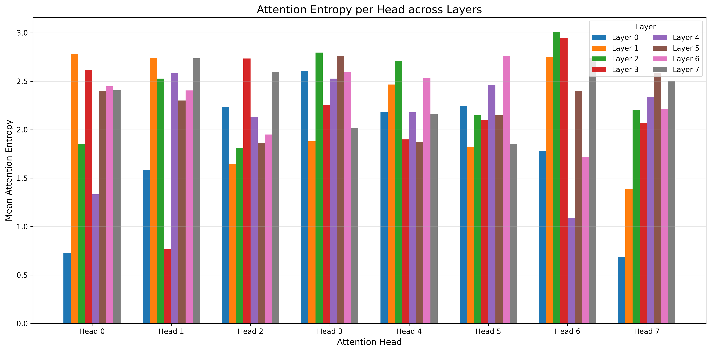


#### Mean Attention Distance

**Telugu**

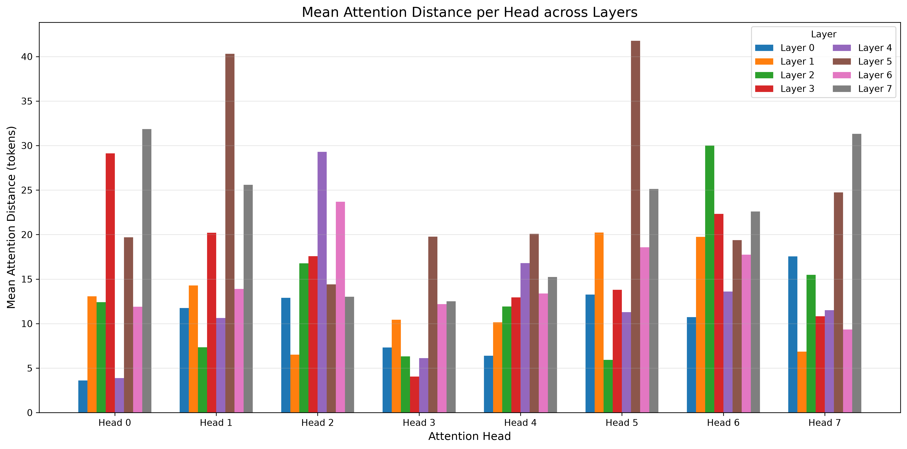


**Nepalese**

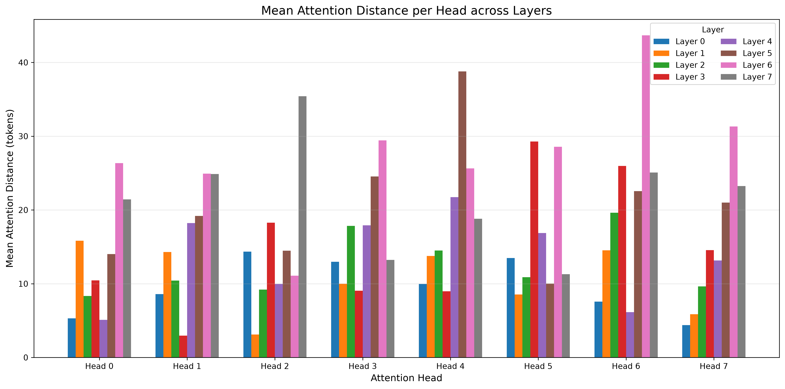


#### Discussion/ Interpretation
